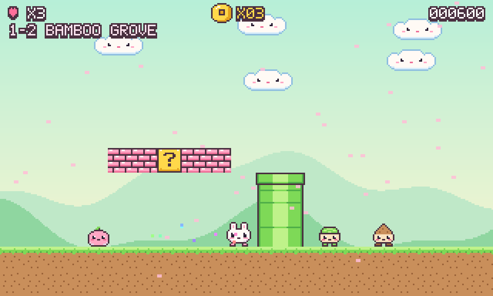
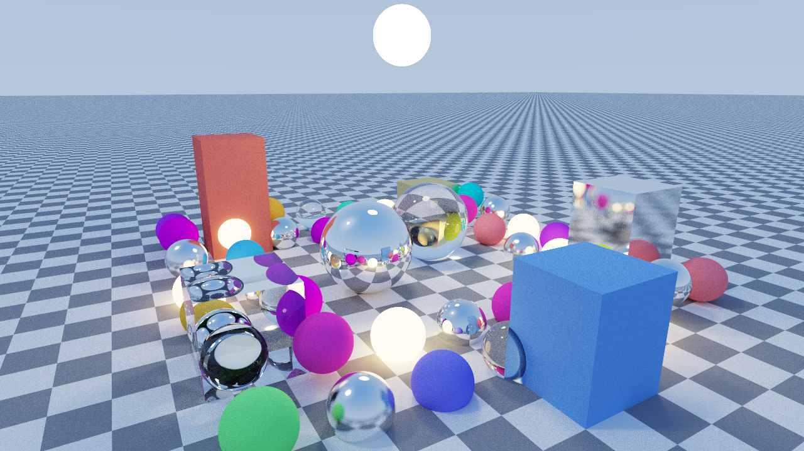

<p align="center">
  
</p>

# nt6-examples

[Nt on GitHub](https://github.com/open-nt) ·
[Examples repository](https://github.com/open-nt/nt6-examples) ·
[Snap package](https://snapcraft.io/open-nt6) ·
[MIT License](LICENSE)

C++ example applications for Nt 6, a small MIT-licensed, Qt 6 compatible implementation of a subset of the
Qt 6 API: widgets, signals and slots, `moc`, SVG, WebSockets, an HTTP server, D-Bus and serial port.
The sources are the ones in the `examples/` directory of Nt, set up to build with CMake against an installed Nt.

## Building

Install Nt, for instance from the snap, and the packages its static libraries link against:

```sh
sudo snap install open-nt6
sudo apt install cmake g++ libssl-dev libfreetype-dev libfontconfig-dev libxcb1-dev
```

Then build and test everything:

```sh
cmake -S . -B build
cmake --build build
ctest --test-dir build
```

The snap's location, `/snap/open-nt6/current/usr`, is searched by default. For an Nt that is installed
elsewhere, pass `-DCMAKE_PREFIX_PATH=<prefix>`.

`hello/`, `signals/` and `widgets/` are also projects of their own, for example
`cmake -S hello -B build-hello && cmake --build build-hello`.

## Examples

| Directory     | Program                                      | Shows                                                         |
|---------------|----------------------------------------------|---------------------------------------------------------------|
| `hello/`      | `hello`                                      | A `QCoreApplication` and a timer                              |
| `signals/`    | `signals`                                    | The signal and slot patterns of the "Signals and Slots" guide |
| `moc/`        | `moc_example`                                | `Q_OBJECT` classes processed by `ntmoc`, as with automoc      |
| `test/`       | `tst_counter`                                | A test written with Nt Test                                   |
| `gui/`        | `hello_window`                               | A window painted with `QPainter`                              |
| `widgets/`    | `hello_widgets`, `gallery`, `render_widgets` | A form, a tour of the widgets, and widgets rendered to PNG    |
| `svg/`        | `svg_viewer`                                 | Showing and converting an SVG file                            |
| `serialport/` | `serialterm`                                 | A serial terminal                                             |
| `websockets/` | `websocket_echo`                             | A WebSocket echo server and client                            |
| `httpserver/` | `hello_server`                               | A small web service                                           |
| `dbus/`       | `dbus_clock`                                 | A clock on the D-Bus session bus                              |
| `platformer/` | `mochimaru`, `sprite_sheet`                  | A platform game: Nt Gamepad, Nt FM sound, a MIDI soundtrack and an OpenGL window |
| `raytracing/` | `pathtracer`                                 | A path tracer on the Vulkan ray tracing pipeline in a `QVulkanWindow`, with the RTX extensions |

Without a display, run the graphical examples with `-platform offscreen`.

## Mochimaru no Daibouken

<p align="center"></p>

`platformer/` is a small, cute platform game. Run `build/mochimaru`, or `build/mochimaru song.mid` (several
files, or a directory of them, work too) to play with your own MIDI soundtrack. The sound effects and the
soundtrack come from the FM synthesizer of Nt FM; the controls come from Nt Gamepad.

| Action        | Gamepad                | Keyboard          |
|---------------|------------------------|-------------------|
| Move          | D-pad or left stick    | Arrows or WASD    |
| Jump          | A                      | Space, Z or Up    |
| Run           | X or B                 | X or Shift        |
| Pause / start | Start                  | Esc or Enter      |
| Music on/off  | Select                 | M                 |
| Next song     | Y                      | N                 |
| Fullscreen    |                        | Alt+Enter or F11  |
| Quit          |                        | Q on the pause screen |

The pixel art is text, in `platformer/sprites.h`; `sprite_sheet` draws all of it on one sheet for review.
`mochimaru --export-song tune.mid` writes the built-in tune, as a starting point for your own.

## Path tracer

<p align="center"></p>
<p align="center"><em>Real-time ray tracing with <code>pathtracer</code>: an Nt-only feature, with no Qt 6 counterpart in <code>qt/</code>.</em></p>

`raytracing/` renders a scene of spheres and boxes with a progressive path tracer that runs on the ray tracing
pipeline of Vulkan (`VK_KHR_ray_tracing_pipeline`) in a `QVulkanWindow`, built the way an RTX game pipeline is:
a few paths per pixel per frame, as many as keep about 90 frames per second, up to 16 bounces; the direct light
chosen by resampled importance sampling (the first stage of ReSTIR: eight candidate lights per hit, one shadow ray);
each pixel's history reprojected through the motion of the camera and of the objects; and an à-trous wavelet
denoiser over the light alone, separated from the surface colour and guided by instance, normal, depth and sample
count, so that the picture is smooth while everything moves and converges exactly, unfiltered, when it rests. Mirrors,
glass and lights are not filtered, so they keep some grain in motion. Run `build/pathtracer`, or `build/pathtracer --fly` to let the camera
circle the scene; `pathtracer --devices` lists the GPUs and `--device N` picks one (by default the first discrete GPU
with ray tracing), `--spp N` fixes the paths per pixel, `--history N` the frames a moving pixel remembers (48 by default),
`--candidates N` the light candidates per hit, `--no-denoise` skips the filter, `--dlss` uses DLSS Ray Reconstruction
(see below), `--scale F` the rendered size over
the window's (by default the rendering stays near 1080p and is upscaled to the window), `--vsync` holds the frames to
the display's rate, `--still`
starts with the scene at rest so the image converges, `--screenshot out.png` saves the picture when `--frames N` are
done, and `--validate` enables the validation layer. It needs a GPU with ray tracing (NVIDIA RTX,
AMD RDNA 2 or later, Intel Arc), or Mesa's `lavapipe` for a slow software run, and an Nt built with the Vulkan
headers. On a GeForce RTX 5070 Ti Laptop GPU it traces about 1.7 billion paths per second at 2560x1440 with 6
bounces, and the picture above converged in a few seconds.

Beyond the core extensions it shows what an RTX GPU adds:

- **Shader execution reordering** (`VK_NV_ray_tracing_invocation_reorder`, Ada and Blackwell): the threads of a wave
  are regrouped by the material they hit before the hit shaders run. Press R to switch it on and off and watch the
  frame rate in the title; the picture does not change.
- **Ray tracing position fetch** (`VK_KHR_ray_tracing_position_fetch`): the closest-hit shader reads the vertices of
  the triangle it hit from the acceleration structure, so the meshes bind no vertex buffers.
- **Procedural geometry**: the spheres are analytic, intersected by an intersection shader, and perfectly round at any
  distance; the boxes and the floor are triangles.
- **DLSS Ray Reconstruction** (opt-in, NVIDIA RTX): one path per pixel, with its albedo, normal, roughness, depth and
  motion vector guides and a sub-pixel jitter, is denoised and upscaled to the window by NVIDIA's DLSS instead of by
  the history and the filter. The DLSS SDK is proprietary and not part of this repository: clone
  [NVIDIA/DLSS](https://github.com/NVIDIA/DLSS) (its licence applies) and configure with `-DDLSS_SDK=<that checkout>`.
  Then `--dlss`, or the N key, turns it on and off.
- **A top level rebuilt every frame** while the scene moves, and shadow rays nested in the hit shaders for the
  direct light.

The window title shows the GPU, the resolution, the frame rate, the paths per pixel and per second, the bounces, the
reordering state, whether the denoiser or DLSS Ray Reconstruction is on, and the sample count once the image converges.

**DLSS Ray Reconstruction** is an opt-in build for NVIDIA RTX GPUs. NVIDIA's DLSS SDK is proprietary and is not
part of this repository: clone https://github.com/NVIDIA/DLSS (its licence applies, and its libraries must not be
redistributed) and configure with `cmake -S . -B build -DDLSS_SDK=<that checkout>`. Then `pathtracer --dlss`, or the
N key, hands each frame to DLSS: one path per pixel at the size DLSS asks for (its Balanced mode), with its guides
(diffuse and specular albedo, normals, roughness, linear depth, motion vectors) and a Halton sub-pixel jitter, and DLSS
denoises and upscales to the window in place of the history and the à-trous filter. `--dlss-mode` picks
`performance`, `balanced` (the default), `quality` or `dlaa` (native resolution, denoising only), and `--spp N` gives
DLSS several paths per pixel for a cleaner input. Without the SDK, or on a GPU
without it, the option is ignored.

A fly-through video is rendered offline, one frame at a time, with `pathtracer --record out --seconds 30`: the scene
and the camera step by the video's frame time, each frame converges over 128 paths per pixel (`--passes` times
`--spp`) before it is saved as a PNG, and ffmpeg, if installed, encodes `out/flythrough.mp4` at `--fps` (30). Use
`--size 960x540` for 1080p on a HiDPI screen, `--no-denoise` for pure path tracing.

| Action                | Control                      |
|-----------------------|------------------------------|
| Orbit the camera      | Drag with the left button    |
| Zoom                  | Mouse wheel                  |
| Pause / resume motion | Space (paused, the image converges) |
| Fly around            | F, or start with `--fly`     |
| Reordering on/off     | R                            |
| Denoiser on/off       | D                            |
| DLSS ray reconstruction | N (SDK build, RTX GPU)     |
| DLSS Ray Reconstruction on/off | N (when built with the DLSS SDK) |
| More / fewer bounces  | + / -                        |
| Screenshot (PNG)      | S                            |
| Quit                  | Q or Esc                     |

## Comparing with Qt 6

`qt/` builds `hello_widgets` and `gallery` against Qt 6 from the same sources. It needs Qt 6 and is a
separate project:

```sh
cmake -S qt -B build-qt && cmake --build build-qt
```

## License

MIT; see [LICENSE](LICENSE).
